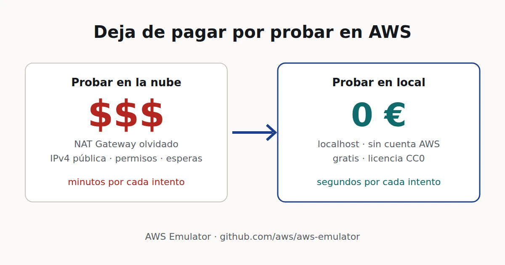

Si desarrollas contra AWS, seguro que te suena: lanzas un despliegue para comprobar un cambio de tres líneas, esperas, falla un permiso, vuelves a lanzar, esperas otra vez. Y al final del mes, una factura con algo que ni recordabas haber creado.

No es mala suerte. Es cómo funciona probar en la nube.

## Dónde se va tu tiempo y tu dinero

- **Recursos olvidados.** La causa más habitual de cargos inesperados no es el uso intencionado, sino lo que se queda encendido. Un solo NAT Gateway olvidado puede suponer unos 60 $ en el primer mes, y [AWS cobra 0,005 $ por hora por cada IPv4 pública](https://builder.aws.com/content/3JW3kTH5S2UOzu1rvebQ1SDin34), la uses o no.
- **Capa gratuita con letra pequeña.** La [documentación de AWS](https://docs.aws.amazon.com/awsaccountbilling/latest/aboutv2/avoid-charges-after-free-tier.html) dedica páginas enteras a cómo evitar cargos tras la capa gratuita. Si hace falta tanta explicación, algo pasa.
- **Ciclos lentos.** Cada prueba real implica desplegar, esperar y limpiar. Multiplícalo por decenas de intentos al día: es tiempo de vida que no vuelve.

## La alternativa que cambió el 11 de noviembre

El 11 de noviembre de 2026 AWS publicó **AWS Emulator**: un servidor local que imita las APIs de AWS para que pruebes tu código en tu propio ordenador, sin cuenta de AWS y [sin coste adicional](https://builder.aws.com/content/3M3sFKDtSXV57FF1cJn0ydVejwI/aws-emulator-run-and-test-aws-services-locally-on-your-laptop-for-free).

Lo que dicen las fuentes:

- **Gratis y abierto.** Se distribuye con licencia CC0 (dominio público) y el código está en [github.com/aws/aws-emulator](https://github.com/aws/aws-emulator), según [Help Net Security](https://www.helpnetsecurity.com/2026/11/12/aws-ai-agents-built-emulator/).
- **Sin nube de por medio.** Funciona como servidor HTTP local en Linux, Windows y macOS, o en Docker. Solo apuntas la CLI o el SDK de AWS a `localhost` ([SiliconANGLE](https://siliconangle.com/2026/11/11/amazons-open-source-aws-emulator-lets-developers-validate-their-code-locally-without-the-cloud/)). En la práctica, es cambiar una variable de entorno, como `AWS_ENDPOINT_URL`.
- **Cientos de servicios**, según SiliconANGLE (ninguna fuente da una cifra exacta).
- **Dato curioso:** AWS afirma que lo escribieron agentes de IA autónomos. Según Matthew Goldberg, ingeniero de AWS, *"nuestro equipo no ha escrito ni revisado ningún código"* ([Help Net Security](https://www.helpnetsecurity.com/2026/11/12/aws-ai-agents-built-emulator/)). Es una afirmación de AWS, no verificada de forma independiente.

## Y LocalStack, ¿qué?

Hasta ahora, la opción por defecto era LocalStack. Pero en 2026 cambió las reglas: [la edición Community dejó de recibir soporte el 23 de marzo](https://blog.localstack.cloud/2026-upcoming-pricing-changes/), la imagen única exige cuenta y token de autenticación, y el plan gratuito [no permite uso comercial](https://blog.localstack.cloud/the-road-ahead-for-localstack/). Si trabajas en una empresa, hoy toca pagar o buscar otra cosa.

## Lo que no hace (sé honesto con tu equipo)

Un emulador no sustituye a AWS. Según la propia cobertura:

- **No es para producción.**
- **Los recursos viven en memoria** y desaparecen al apagarlo.
- **IAM y las políticas no se evalúan como en AWS:** no sirve para probar seguridad.
- **La fidelidad varía por servicio**, y es una región y una cuenta por instancia.
- Por defecto envía **datos anónimos de uso y errores** a AWS (se puede desactivar; no envía tus peticiones ni tus recursos).

## Cómo usarlo con cabeza

1. **Lógica y flujos:** emulador, todo el día, gratis.
2. **Permisos, rendimiento y red:** una prueba final en AWS real, una vez, antes de publicar.
3. **Presupuesto y alertas** activos igualmente en tu cuenta.

Resultado: pagas por la nube cuando de verdad necesitas la nube, no por cada tecla que tocas.

---

**Fuentes**

- [AWS Builder Center: AWS Emulator](https://builder.aws.com/content/3M3sFKDtSXV57FF1cJn0ydVejwI/aws-emulator-run-and-test-aws-services-locally-on-your-laptop-for-free)
- [Help Net Security, 12/11/2026](https://www.helpnetsecurity.com/2026/11/12/aws-ai-agents-built-emulator/)
- [SiliconANGLE, 11/11/2026](https://siliconangle.com/2026/11/11/amazons-open-source-aws-emulator-lets-developers-validate-their-code-locally-without-the-cloud/)
- [Repositorio aws/aws-emulator](https://github.com/aws/aws-emulator)
- [LocalStack: cambios de precios](https://blog.localstack.cloud/2026-upcoming-pricing-changes/) y [The Road Ahead](https://blog.localstack.cloud/the-road-ahead-for-localstack/)
- [AWS Builder Center: cargos inesperados](https://builder.aws.com/content/3JW3kTH5S2UOzu1rvebQ1SDin34) y [AWS Billing: evitar cargos](https://docs.aws.amazon.com/awsaccountbilling/latest/aboutv2/avoid-charges-after-free-tier.html)
